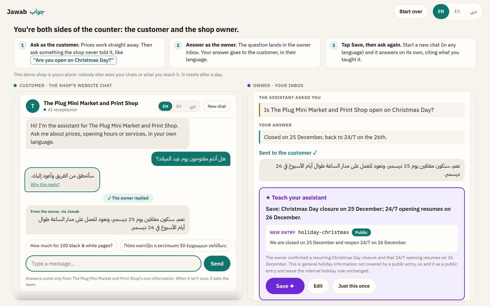

# Jawab · جواب

An AI receptionist for small businesses that **never guesses**. It answers customers in their own language (tested in English, Greek and Arabic, including Greek and Arabic typed in Latin letters) from the owner's own information. When it doesn't know, it **asks the owner**, passes the answer on to the customer in their language, and **learns it with one tap**. A new business sets itself up in a few minutes by pasting its price list.

**[Try it: be the customer and the owner →](https://jawab-fb4z.onrender.com/try)** You get your own private copy of a real print shop. Ask it "Are you open on Christmas Day?", answer as the owner in the inbox next to the chat, tap Save, start a new chat and ask again.

<sub>The demo runs on free hosting that sleeps when nobody's using it, so the first visit can take about a minute to wake up. Your demo shop is private to you and resets after a day.</sub>



Built in one day (31 Oct 2026) at the **Founding MENA x Replit Hackathon** in Dubai, on top of the engine of my earlier project, [Shop Assistant](https://github.com/zeinsaid/Shop-Assistant).

---

## What it does

| For | What they get |
|---|---|
| **Customers** | A chat on the shop's website (a one-line script tag adds a chat bubble) that answers prices, hours and services in their language, and cites the shop's own information. The page itself comes in English, Greek or Arabic (right to left), as the business chooses. |
| **The owner** | An inbox of the questions the bot couldn't answer and the chats it handed to a person. Each answer goes to the customer, rewritten in their language, and comes with a draft knowledge entry: **Save**, **Edit** or **Just this once**. |
| **A new business** | `/start`: paste a price list, menu or website text, answer a few short questions, review the drafted knowledge base and publish. The bot is live straight away. |

The loop that makes it different:

```
customer: "هل أنتم مفتوحون يوم عيد الميلاد؟"        (are you open on Christmas Day?)
  bot: the knowledge base doesn't say  →  ask_owner: "I'll check with the team"
owner: "Closed on the 25th, back to 24/7 on the 26th."
  bot → customer, in Arabic: the owner's answer
  bot → owner: "Save this?  holiday-christmas (public): Closed on 25 December..."   [Save]
next customer, in English: "are you open on christmas day?"
  bot: answer, citing holiday-christmas ✦ Learned
```

## Built on the Shop Assistant engine

Jawab is a product built on an engine. The engine decides what to say; Jawab is the business around it.

| Layer | Repo | What it is |
|---|---|---|
| **Engine** | [Shop-Assistant](https://github.com/zeinsaid/Shop-Assistant) | The brain: one decision per message (`answer`, `ask_owner` or `handoff`), answers that must cite a public knowledge-base entry or code turns them into a question for the owner, internal rules that never reach customers, one corrective retry and a safe fallback. Also the learning call and the onboarding interview, and their prompts. Proven on a **130-case evaluation** across Anthropic, OpenAI and Google models. |
| **Product** | Jawab (this repo) | Multi-business web app: database, customer chat, owner inbox and learning, `/start` onboarding, the embeddable bubble, the landing page, rate limits, the public demo's sandboxes. |
| **Businesses** | data in Jawab's database | Each business is one markdown knowledge base plus settings. The Plug, a real print shop in Nicosia with its real prices, is the demo. Nothing business-specific is in the code. |

Jawab installs the engine as a Python package, pinned to a release tag:

```toml
dependencies = ["shop-assistant[openai]"]

[tool.uv.sources]
shop-assistant = { git = "https://github.com/zeinsaid/Shop-Assistant", tag = "v1.1.0" }
```

and uses it like any library:

```python
from brain.brain import Brain        # decide(message) -> one checked decision
from brain.learn import Learner      # owner's answer -> reply for the customer + draft KB entry
from onboarding.interview import Interview
```

Building Jawab improved the engine, and those changes went back into it: Arabic support, "learned entries win over ask-the-owner rules", the learning call, a quick five-minute interview, and language notes that switch on per business (a Greek shop gets the Greeklish notes, an Arabic one the Arabizi notes). Since v1.1.0 every handoff also says **why** (`abuse`, `complaint`, `lead` or `other`), and Jawab routes on it: a complaint or a lead emails the shop, a troll gets a polite goodbye and nobody is bothered.

## Running it for a real business

The same code runs two ways. The public demo is one deployment; The Plug's own chat, on its new website, is another.

| | Public demo (`render.yaml`) | A business's own (`render.plug.yaml`) |
|---|---|---|
| Mode | `JAWAB_MODE=multi` (default) | `JAWAB_MODE=single`, `JAWAB_BUSINESS=the-plug` |
| Pages | landing, `/try` sandboxes, `/start` onboarding, demo shop | only that business's chat and inbox; everything else is a 404 |
| Database | SQLite on the free server's disk, wiped on restart (on purpose) | Postgres (`DATABASE_URL`, e.g. Neon); required in this mode |
| Email | only the offline alert | alerts, and answers to customers |

**Single-business mode** is what lets a business run Jawab on its own key safely: nobody can create a business, open a sandbox or start an onboarding, so the key is only spent on that business's own chat. Every lookup is limited to the one business.

**Per-business settings** (`app/services/settings.py`) sit next to the knowledge base: the short display name, an accent colour for the bubble and the chat page (made readable automatically: text on The Plug's neon `#F920EB` is darkened just enough to pass WCAG AA), the message shown when the chat is offline, a contact line under replies that need a person ("For anything urgent, call..."), a reply-to address, and switches for alerts and for emailing customers. Seeded businesses get them from their seed, and they're rewritten on every start: settings are configuration. On the public demo every demo copy gets a safe overlay instead: no real contacts, no emails to customers, no alerts. Otherwise a visitor could type any address as "their" email, answer as the sandbox owner, and make the shop's domain send whatever they liked.

**Page languages vs reply languages.** A knowledge base's `languages:` line says which languages the bot handles (it turns on the engine's notes for Greeklish or Arabizi); a `ui_languages:` line says which ones the chat page's toggle offers. The Plug's website is English and Greek, so its toggle is `en, el`, but an Arabic message still gets an Arabic answer.

**Alerts** (Resend, over HTTPS, since free hosts block SMTP; `app/services/alerts.py`):

| Event | Who's emailed |
|---|---|
| `ask_owner` (the bot doesn't know) | the owner (`OWNER_ALERT_EMAIL`): the question, the customer's language, a link to the inbox (never the key) |
| `handoff`, reason `complaint` or `lead` | the shop (`SHOP_ALERT_EMAILS`): a short summary, the conversation, the customer's email if given |
| `handoff`, reason `other` or `abuse` | nobody (`other` stays in the inbox; `abuse` ends the chat) |
| the model can't be reached | the owner, at most every 6 hours per deployment, saying why: out of credit, rate-limited, provider down, or other |
| the owner answers | the customer, in their language, if they left an email |

Recipients come from env vars, never from the repo. One email per event.

**The customer side.** After a question goes to the owner, the chat offers *"Leave your email and we'll send you the answer"*. Every reply that needs a person ends with the business's contact line, except an abuse goodbye. If the model call fails (no credit, quota, timeout, provider down) or the server can't be reached, the chat shows the business's own offline message in the customer's language: never an error or a broken bubble.

**The website bubble** is a small loader the website hosts itself ([`docs/EMBED.md`](docs/EMBED.md)), so it appears at once even while a free server sleeps. It pings `/health` on page load to wake the server, shows a local greeting in the page's `<html lang>`, and hands the customer's first message to the real chat once it's ready, or shows the offline message after about a minute. The conversation ID lives in the website's own storage, so a returning visitor finds the owner's answer waiting.

**Where the knowledge lives.** Where a business runs for real, **its database is the source of truth** for its live knowledge base: the answers the owner saves go there. `kb/the-plug.md` in this repo is only the seed used on the first start, and the copy in the engine's repo is an evaluation fixture. Nobody keeps the three in sync.

**Hosting.** Both run on Render's free plan, which sleeps after 15 idle minutes and gives 750 free hours a month per workspace, shared by all free services (if they run out, every free service stops until the month ends). Moving a deployment to a paid instance is only a plan change in its blueprint, no code change.

## How it was built

- **Before the day:** I wrote the product spec, the phase plan and the test script ([`docs/`](docs/)), adapted the engine's prompts for Arabic, and tested them live against the model the night before.
- **On the day (8:30 to 17:00):** Replit Agent built the app phase by phase from that spec: customer chat, owner inbox, learning, onboarding, landing page. After every phase I tested it on the published app (scripted HTTP checks plus manual checks on a phone) before starting the next. The engine was reused, not rewritten.
- **After the day:** with [Claude Code](https://claude.com/claude-code), I moved it off Replit: the engine became an installable package that Jawab depends on, the hosting moved to Render, and the public demo got private sandboxes and tighter spending limits.

## Running it locally

Needs Python 3.12+ and [uv](https://docs.astral.sh/uv/).

```
uv sync          # install dependencies, including the engine from GitHub
uv run pytest    # run the tests (no API key needed)

# The app at http://localhost:8000. Without OPENAI_API_KEY it calls no model and costs nothing
# (every message goes to the owner). Data goes into a local SQLite file, jawab.db.
uv run uvicorn app.main:from_env --factory --reload
uv run --env-file .env uvicorn app.main:from_env --factory
```

Copy `.env.example` to `.env` for the settings: `OPENAI_API_KEY`, and optionally `DATABASE_URL` (any Postgres database, for data that must last), `PLUG_OWNER_KEY`, the single-business mode, CORS and the email settings. Every one is listed in `.env.example` and at the top of `app/main.py`.

| Page | What it is |
|---|---|
| `/` | Landing page (English / Greek / Arabic) |
| `/try` | The public demo: your own sandbox, customer chat and owner inbox side by side |
| `/b/{slug}` | A business's customer chat (`?panel=1` adds the "Behind the reply" panel) |
| `/owner/{slug}` | The owner's inbox, knowledge and share links (asks for the owner key once per device) |
| `/start` | Onboarding a new business |
| `/jawab.js` | The website chat bubble, for a website to host itself ([`docs/EMBED.md`](docs/EMBED.md)) |
| `/embed.js?b={slug}` | The same bubble with a business's settings filled in, e.g. on [a demo shop site](https://jawab-fb4z.onrender.com/demo/the-plug) |

## Repository layout

```
├── app/
│   ├── main.py         # FastAPI: pages, customer API, owner API, onboarding, sandboxes
│   ├── db.py           # SQLAlchemy models (every table has a business_id) and seeding
│   ├── limits.py       # Rate limits that protect the API credit
│   ├── services/       # Conversations, owner inbox and learning, KB edits, onboarding, sandboxes,
│   │                   # per-business settings, the accent theme, alerts and email
│   └── static/         # Plain HTML, CSS and JavaScript; no build step (jawab.js is the bubble)
├── kb/the-plug.md      # The Plug's knowledge base: the seed for a new database
├── docs/               # The spec, test script and demo business written for the hackathon; EMBED.md
├── tests/              # pytest, on an in-memory database with scripted model responses
├── render.yaml         # Hosting for the public demo (Render, free plan)
└── render.plug.yaml    # Hosting for The Plug's own chat (single-business mode, Postgres)
```

## The public demo's limits

The demo calls a real model, so it's protected: per-visitor and daily caps on model calls (`app/limits.py`), at most three onboardings per visitor a day, and a spending cap at the provider. Sandboxes are deleted after a day, and the free server's database is wiped whenever it restarts.

Known simplifications, fine for a demo and for one owner, to change for many real customers: one owner key per business instead of a login (the inbox asks for it once per device, and alert emails never contain it), `/start` needs no sign-up, and the rate limits live in memory on one server.

## Data and privacy

The Plug's knowledge base has the shop's real public prices. The demo keeps conversations only in its temporary database, and the model provider is called with storage turned off. Where a business runs for real, conversations (and a customer's email, if they leave one for an answer) are kept in its own database.
